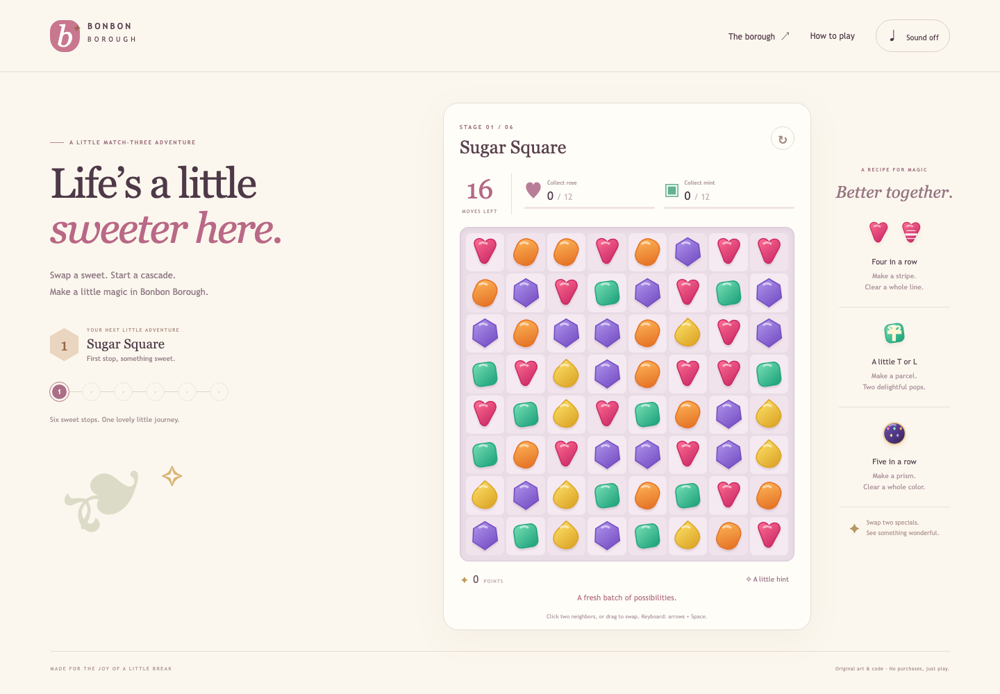

# Bonbon Borough

An original, finite browser match-three adventure closely inspired by the traditional Candy Crush Saga loop. Swap glossy sweets, plan combinations, clear layered glaze and meringue, and visit six original stages. All art is original SVG/CSS, audio is synthesized, and code and level layouts are original. No King assets, purchases, accounts, ads, lives timers, or network services at runtime.



## Play locally

Requires Node.js 24 and npm.

```sh
npm ci
npm run build
npm run preview
```

Open **http://127.0.0.1:5226/**. The port is reserved for this project; `--strictPort` prevents silently taking another game's port. Development: `npm run dev -- --port 5226 --strictPort`.

Click/tap a sweet and a neighbor, or drag/swipe between adjacent cells. Keyboard: arrows move focus; Space/Enter selects and swaps; Escape cancels. An invalid swap returns without spending a move. The hint is free. Restart retries the current stage, and The borough opens the stage map. Progress and the current settled board save automatically to this origin's unique `bonbon-borough:campaign:v1` key; no other game keys are touched. Sound is off until enabled. Reduced motion is respected. Clearing browser storage removes local progress; storage failures leave the session playable.

## A recipe for magic

| Make or combine | Result |
| --- | --- |
| Four in a line | Stripe following the direct swipe direction |
| Five in a line | Prism; swap it with a color to clear that color |
| T/L intersection | Parcel: 3×3 pop, gravity, then another pop at its new position |
| Stripe + stripe | Row and column cross |
| Stripe + parcel | Three rows and three columns |
| Parcel + parcel | Two 5×5 pulses, clipped at edges |
| Prism + stripe/parcel | Convert partner-color sweets to that special and activate them |
| Prism + prism | Board-wide pulse |

Special combinations work across colors. Matching on glaze removes one layer; meringue loses a layer from an adjacent **match** or a direct special hit. Overlapping hits damage only once per pulse. Gravity/refill, cascades and delayed pops all belong to one move. Completing objectives on the final move wins. Dead boards reshuffle for free while preserving sweet/special inventory and stationary terrain.

The campaign progresses through color collection, glaze clearance, layered meringue, special creation, prism combinations, and a mixed finale. Early stages teach the loop; later stages need more planning. Every stage can be retried and unlocked stages replayed.

## Scope and sources

This targets a coherent classic **Saga** subset, not Soda/Jelly Saga or an exact King release. Official King help establishes [swap controls](https://candycrush.zendesk.com/hc/en-us/articles/360000750278-Controls-how-to-switch-and-match-candies), [special recipes/effects](https://candycrush.zendesk.com/hc/en-us/articles/211939685-Creating-and-combining-Special-Candies) and [blockers](https://candycrush.zendesk.com/hc/en-us/articles/360000754717-Which-Blockers-can-I-find-in-the-game). [Research and combination cross-checks](docs/research.md) record secondary corroboration, conflicting historical descriptions, and version choices.

The game uses modern prism+parcel conversion and traditional match/combine activation. King's limited-group tap-to-activate experiment, square-created fish, supercharged wraps, boosters, ingredients/dragons, spreading chocolate, portals, irregular boards and live-service features are omitted. Scoring, RNG, tie-breaks, cascade stripe orientation and the fixed destination anchor for double-parcel pulses are project rules. These differences are explicit, not assertions of complete parity.

## Validation

```sh
npm run typecheck
npm test
npm run format:check
npm run build
npx playwright install chromium
npm run test:browser
npm run simulate
```

Engine/save tests exercise real public operations with independently specified fixtures, including all pair families, unique-color prism partners, blocker footprints, wrapped gravity, final-move objectives, dead boards, corrupt saves and deterministic replay. Playwright uses an isolated headless browser with ordinary visible controls, including completing all six stages without injecting game state. The objective-first campaign simulation is computational evidence, not human play or a difficulty guarantee. See [verification](docs/VERIFICATION.md) and [reproducible campaign paths](docs/campaign-simulation.json).

CI checks types/tests/format/build on Linux, Windows and macOS; headless Chromium acceptance runs on Linux. Native Mac acceptance is separately identified in verification; no Windows browser, mobile device or screen-reader testing is implied.

## Project

- [Spec and settled design](docs/SPEC.md), [glossary](CONTEXT.md), [scope decision](docs/adr/0001-bounded-classic-rules.md)
- Gitignore includes the complete official GitHub [Linux](https://github.com/github/gitignore/blob/main/Global/Linux.gitignore), [Windows](https://github.com/github/gitignore/blob/main/Global/Windows.gitignore), and [macOS](https://github.com/github/gitignore/blob/main/Global/macOS.gitignore) Global templates plus project ignores.
- [MIT License](LICENSE). Candy Crush Saga is a King trademark; this independent learning project is unaffiliated.
